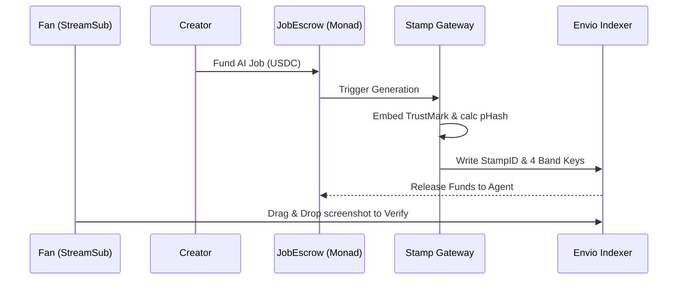

# Stamp
*A creator platform where every AI-made file carries a verifiable origin (Monad Metropolis, Track 04).*

**The Problem:** Provenance metadata (C2PA) is instantly destroyed when an image is screenshotted, cropped, or re-compressed on social media. Fans cannot tell human art from AI, and creators cannot prove ownership.

**The Solution:** Stamp inextricably links payment, generation, and watermarking. Agents are paid via smart contracts to generate art; getting paid triggers an invisible pixel-level watermark and perceptual fingerprint, which are permanently logged on Monad.

**Why Monad?** Stamping individual images requires high-frequency, low-latency micro-transactions. Monad's parallel execution and near-zero fees make a high-volume provenance registry economically viable.

## How it works
- Layer 1: invisible watermark (Adobe TrustMark, 40-bit stampId, built-in ECC)
- Layer 2: pHash fingerprint, 8 bands x 8 bits (lookup guaranteed up to Hamming 7)
- Registry: ProvenanceRegistry on Monad testnet, indexed by Envio

## Watermark test results
10 AI-generated images (mixed styles), each stamped, then attacked. Single run, random IDs, n=10: results moved by 1-4 images between runs.

| Attack | TrustMark decoded | invisible-watermark (best variant) | pHash median distance |
|---|---|---|---|
| none | 10/10 | 10/10 | 0 |
| JPEG q40 | 8/10 | 0/10 | 0 |
| resize 50% | 10/10 | 10/10 | 0 |
| crop 20% | 9/10 | 0/10 | 22 |
| screenshot (75% shrink + blur + JPEG 70) | 9/10 | 0/10 | 0 |
| crop + JPEG q40 | 4/10 | 0/10 | 22 |
| crop + screenshot | 7/10 | 0/10 | 22 |
| resize 50% + crop + JPEG q40 | 1/10 | 0/10 | 22 |

- Unrelated images sit 20-44 apart in pHash. Match threshold: 7.
- pHash does not survive crops (22 is inside the stranger range), so cropped copies rely on the watermark.
- Known limits: stacked attacks (crop + JPEG, resize + crop + JPEG) often defeat the watermark. This is a provenance signal, not proof of authenticity.
- False positives on never-stamped images: 0/30.

### Crop recovery
Verify also pads the image back out as if a 10-30% crop had been taken from the center or a corner, then decodes again. 12 photos, `python worker/crop_test.py`:

| Attack | As given | With crop recovery |
|---|---|---|
| crop 20% from a corner | 11/12 | 12/12 |
| crop 35% | 0/12 | 12/12 |
| resize 50% + crop 20% + JPEG q40 | 10/12 | 12/12 |
| JPEG q40, resize, center crop, screenshot | 12/12 | 12/12 |

No stamp was reported on any unstamped image, including 576 padded decodes. An unstamped image takes about 3 s to verify. Videos skip this step because it cost about 40 s per clip.

### Video
Video frames are stamped at strength 2.0 instead of 1.0, and verify reads 16 frames instead of 6. A stamp found in one frame is accepted only if it is already registered; an unknown stamp needs two frames to agree. Three test clips, re-encoded at CRF 30, frames decoded out of 16:

| Attack | Strength 1.0 | Strength 2.0 |
|---|---|---|
| re-encode only | 4-15 | 9-16 |
| center crop 20% | 0-12 | 15-16 |
| corner crop 20% | 0 | 5-12 |
| scale 50% | 0 | 6-7 |

Cost: PSNR drops from 43.4 dB to 37.8 dB. The four demo clips were stamped at 1.0 and keep that, because their unstamped originals were not kept. Verifying a video takes about 20 s.

## Status
- [x] **Watermark + pHash Core Spike:** Completed (`worker/stampcore.py`)
- [x] **Agent Identity Registry (ERC-8004):** Completed (`contracts/src/AgentRegistry.sol`)
- [x] **Provenance Registry Contract:** Completed (`contracts/src/ProvenanceRegistry.sol`)
- [x] **JobEscrow Payment System:** Completed (`contracts/src/JobEscrow.sol`)
- [x] **Envio Indexer & Gateway Connection:** Completed
- [x] **Verify Page UI & Browser Login:** Completed

## Run the worker

Python 3.10. On Windows run this first in PowerShell: `$env:PYTHONUTF8="1"`
Then: `pip install -r worker/requirements.txt`
Put test images in imgs/ (not committed), then: `python worker/spike2.py`

## Bounties Claimed
* **Monad Track 04 (Trust, Identity & AI):** Core submission, live on Monad testnet (chain 10143).
  * Agents stake 10 MON in `AgentRegistry` (`0x03457d1A96F59DE34A47Bf655113C37E6CD49dD9`). They can change their model later through `ModelProfile` (`0x5DB23062e917c4770C8De8c216e53677d7Af1A8D`) without staking again.
  * The provider hashes its local weights and refuses to generate unless the hash matches the one on chain.
  * Fans pay for a job in `JobEscrow` (`0xfaD7b70c439c6C528B378236EDF08EfE49F9066b`). The gateway stamps the image or video, attests it in `ProvenanceRegistry` (`0x4A934ACF37787E5A219Fd0FC67617929cbA1509f`), then the job pays the agent.
  * Stamps survive JPEG, resizing, screenshots and crops up to 35% on images, and a re-encode plus a 20% crop on video. See the tables above.
  * Verify also reads real C2PA manifests on images and video, so AI content made elsewhere is labeled too.
  * Memberships bill by the second through `StreamSub` (`0xacc99682B4304a6B85B0A63a004DFf2b196BfA59`). The unused deposit stays in the contract and returns to the fan on cancel.
* **Chainlink CRE:** `cre/stamp-verify` is a CRE workflow that checks a decoded stamp id against the gateway record and the registry. The Verify page runs it with `cre workflow simulate`. Limits: it is simulated, not deployed, and CRE has no named selector for Monad yet, so the chain read in the workflow is not live.
* **Envio:** `indexer/config.yaml` indexes `Stamped` events from `ProvenanceRegistry` on Monad testnet, including the pHash bands, for GraphQL lookups. Limits: the stamp id is a `string indexed` field, so the event carries its hash, not the id. Verify falls back to reading the contract directly when the indexer is not running.